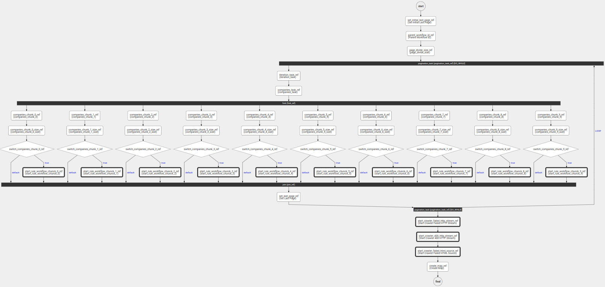
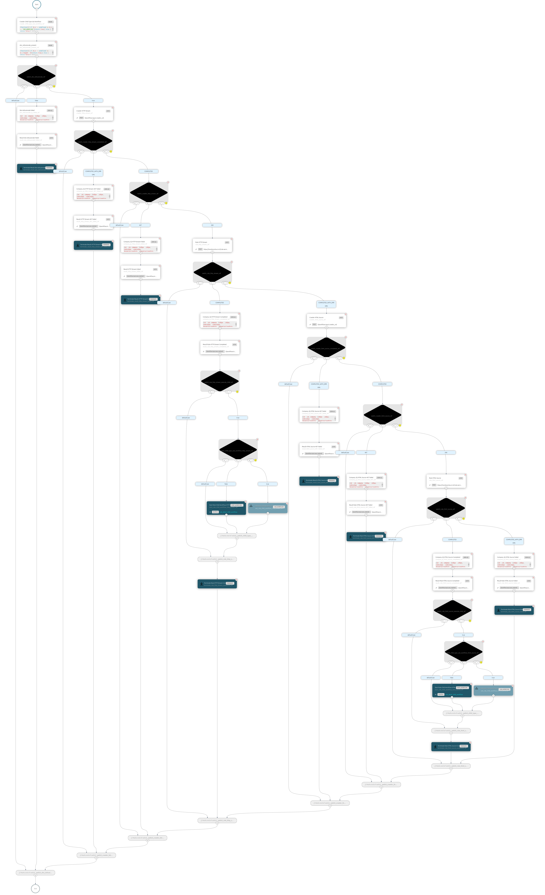

# Coordinatore delle attività di crawling

Il coordinatore è basato su [Netflix - Conductor](https://conductor-oss.org) una piattaforma gratuita e open source per l'orchestrazione dei microservizi, attraverso flussi di lavoro che definiscono le interazioni tra servizi, il progetto principale è stato [forkato](https://github.com/cnr-anac/conductor) per permettere e gestire l'autenticazione e l'autorizzazione sull'esecuzione dei flussi e sul passaggio della stessa ai microservizi invocati dal flusso. 

Nel progetto sono presenti le definizioni in formato *json* dei flussi necessari al completamento degli obiettivi del progetto.

## Main - Amministrazione Trasparente

Il flusso [principale](crawler_amministrazione_trasparente.json) necessita dei seguenti parametri di input per la sua corretta invocazione:

| Nome                       | Descrizione                                                    | Valore consigliato/default  | Vuoto? |
|----------------------------|----------------------------------------------------------------|-----------------------------|--------|
| page_size                  | Dimensione della pagina per il recupero delle PA               | 2000                        | No     |
| parent_workflow_id         | Identificativo del flusso, viene valorizzato con UUID generato | vuoto                       | Si     |
| codice_categoria           | Se valorizzato filtra le PA che fanno parte della categoria    | vuoto                       | Si     |
| codice_ipa                 | Se valorizzato individua la singola PA                         | vuoto                       | Si     |
| crawling_mode              | Modalità base di esecuzione del crawler (httpStream/htmlSource)| httpStream                  | No     |
| crawler_save_object        | Booleano indica se salvare sempre la pagina HTML               | false                       | No     |
| crawler_save_screenshot    | Booleano indica se salvare sempre lo screenshot della pagina   | false                       | No     |
| rule_name                  | Nome della regola                        					  | amministrazione-trasparente | No     |
| root_rule                  | Nome della regola di base dell'albero    					  | amministrazione-trasparente | No     |
| execute_child              | Booleano indica se controllare le regole figlie                | true                        | No     |
| force_jsoup              	 | Forza l'utilizzo di JSOUP per determinare gli anchor           | true                        | No     |
| id_ipa_from                | Identificativo numerico della PA da cui partire                | 0                           | No     |  
| connection_timeout         | Timeout in millisecondi della connessione                      | 60000                       | No     | 
| read_timeout               | Timeout in millisecondi della lettura                          | 60000                       | No     | 
| connection_timeout_max     | Timeout massimo in millisecondi della connessione              | 120000                      | No     | 
| read_timeout_max           | Timeout massimo in millisecondi della lettura                  | 120000                      | No     | 
| crawler_child_type         | Modalità di esecuzione dei flussi figli (SUB/START)_WORKFLOW   | START_WORKFLOW              | No     |
| rule_base_url              | URL di base del microservizio delle Regole                     | *URL*                       | No     |
| public_company_base_url    | URL di base del microservizio delle PA                         | *URL*                       | No     |
| result_aggregator_base_url | URL di base del microservizio Aggregato                        | *URL*                       | No     |
| result_base_url            | URL di base del microservizio dei Risultati                    | *URL*                       | No     |
| crawler_uri                | URL di base del microservizio Crawler                          | *URL*                       | No     |

Il primo [TASK](crawler_amministrazione_trasparente.json#L8-L22) del flusso si occupa di invocare l'aggiornamento della configurazione del microservizio delle regole, dopo aver valorizzato la variabile necessaria al controllo delle pagine elaborate, il flusso invoca il [microservizio delle PA](crawler_amministrazione_trasparente.json#L71-L85) e recupera le informazioni necessarie.

Il blocco recuperato contentente le informazioni di *n* PA viene parcellizzato in base al parametro fornito in input **page_size** e diviso per *10*, utilizzando infine il [TASK FORK/JOIN](https://orkes.io/content/reference-docs/operators/fork-join) vengono eseguiti in parallello *10* istanze del flusso [Rule](rule_workflow.json) valorizzando il parametro in input [companies](rule_workflow.json#L418).

All'uscita del [TASK delle PA](crawler_amministrazione_trasparente.json#L52-L60), se il flusso è stato eseguito non per una singola PA, allora vengono rielaborati i risultati con i codici *400* e *407* con i timeout massimi ed eseguiti i flussi [Crawler Result Failed](crawler_result_failed.json).

Infine viene eseguito il [TASK](crawler_amministrazione_trasparente.json#L581-L596) per elaborare la Mappa geolocalizzata dei risultati.  

Di seguito l'immagine del flusso:



## RULE DETAIL

Il flusso [Rule](rule_workflow.json), oltre a lanciare il flusso Rule Detail, avvia anche il flusso [AT Map](#at-map) per la stessa PA, se la URL del sito istituzionale è presente. Questo avviene sia nel ramo `PUT` (esecuzione principale, solo per le PA non ancora elaborate) sia nel ramo `POST` (rielaborazione dei risultati falliti da [Crawler Result Failed](crawler_result_failed.json)). Nel secondo caso, il salvataggio dell'ATmap può fallire per il vincolo di unicità se era già stata salvata: l'errore viene ignorato.

Il flusso [Rule Detail](rule_detail_workflow.json) eseguito per una singola PA passata come parametro in input [ipa](rule_detail_workflow.json#L860), controlla inizialmente la [presenza della URL istituzionale](rule_detail_workflow.json#L19-L28) e successivamente invoca il [crawler](rule_detail_workflow.json#L38-L52) il cui risultato viene passato al [microservizio delle regole](rule_detail_workflow.json#L76-L92) la cui risposta è utilizzata come input al [Task dei risultati](rule_detail_workflow.json#L261-L277)    

Di seguito l'immagine del flusso:



## AT MAP

Il flusso [AT Map](at_map_workflow.json) (versione 2) cerca il file **ATmap** ANAC (mappa dei link di Amministrazione Trasparente) del sito istituzionale di una PA, ne recupera il contenuto e lo salva nel microservizio dei Risultati. Viene avviato in modalità *START_WORKFLOW* da [rule_workflow.json](rule_workflow.json) (vedi sopra) solo se la PA ha una URL del sito istituzionale.

Parametri di input:

| Nome               | Descrizione                                                                         | Vuoto? |
|--------------------|-------------------------------------------------------------------------------------|--------|
| ipa                | PA da elaborare (oggetto con almeno *id*, *codiceIpa*, *sitoIstituzionale*)         | No     |
| parent_workflow_id | Identificativo del flusso padre, usato come *workflowId* del risultato; se vuoto si usa l'id del flusso corrente | Si |
| connection_timeout | Timeout in millisecondi della connessione                                           | No     |
| read_timeout       | Timeout in millisecondi della lettura                                               | No     |
| result_base_url    | URL di base del microservizio dei Risultati                                         | No     |
| crawler_uri        | URL completo dell'endpoint `/crawl` del microservizio Crawler                       | No     |

Logica di ricerca, in ordine:

1. **robots.txt**: legge `<origine>/robots.txt` del sito istituzionale e cerca le direttive `ATmap:` (URL assoluti o relativi). Se ce ne sono più di una (es. una `.xml` e una `.json`) viene preferita la `.xml`.
2. **`<origine>/at_map.xml`**: solo se l'ATmap non è stata trovata al punto precedente (o non è valida).
3. **`<origine>/at_map.json`**: solo se non è stata trovata neppure la `.xml`.

Tutti i file (robots.txt, ATmap dichiarata, `at_map.xml`, `at_map.json`) sono scaricati tramite il [microservizio Crawler](https://github.com/TrasparenzAI/crawler-service) con `crawlingMode: htmlSource`, che restituisce il contenuto in *base64*. Il flusso lo decodifica (UTF-8) e gestisce i casi particolari: contenuto racchiuso in un `<html><pre>…</pre></html>`, formato `b'…'`, recinti di codice ```` ```json ````. Per ogni file viene verificato che il contenuto sia effettivamente **XML** o **JSON** valido (una pagina HTML di errore con codice 200, "soft 404", viene scartata).

Il risultato viene scritto con [PUT /v1/atmaps](https://dica33.ba.cnr.it/swagger-ui/#/ATMap%20Controller/create_2) del microservizio dei Risultati, anche in caso di esito negativo, con i seguenti campi:

| Campo        | Descrizione                                                                          |
|--------------|--------------------------------------------------------------------------------------|
| idIpa, codiceIpa | Identificativo e codice IPA della PA                                             |
| workflowId   | Identificativo del flusso padre (o del flusso corrente)                              |
| found        | `true` se è stata trovata una ATmap valida                                           |
| url          | URL da cui è stata letta (o dichiarata nel robots.txt ma non valida)                 |
| status       | Codice di risposta del crawler                                                       |
| content      | Contenuto testuale dell'ATmap                                                        |
| format       | `XML` o `JSON`                                                                       |
| discoveredBy | `ROBOTS_TXT` (dichiarata nel robots.txt) o `WELL_KNOWN_URL` (`at_map.xml`/`at_map.json`) |
| valid        | Validità del file                                                                    |
| errorMessage | Motivo dell'esito negativo (sito istituzionale assente, ATmap non trovata o non raggiungibile) |

Il task di salvataggio è *opzionale*: un suo errore non interrompe il flusso. Il vincolo di unicità del microservizio è `(workflowId, codiceIpa)`.

Output del flusso: `codiceIpa`, `sitoIstituzionale`, `robotsUrl`, `robotsStatus`, `robotsDeclaredUrl(s)`, `atMapStatus` (`FOUND`, `NOT_FOUND`, …), `atMapSource` (`ROBOTS`, `DEFAULT_XML`, `DEFAULT_JSON`), `atMapUrl`, `atMapFormat`, `atMapContent`, `atMapSaved`, `atMapId`.

## SCRIPT UTILI

- [Inizializzazione del sistema](init.sh) Utilizzato per il SETUP iniziale (registra le definizioni dei flussi, compreso [AT Map](at_map_workflow.json); va rieseguito dopo ogni modifica).
- [Cancella workflow](delete_workflow.sh) Data una lista di workflow itera e cancella i dati
- [Avvia workflow Totale](start.sh) Avvia un flusso totale con i parametri di default
- [Avvia workflow per singola Amministrazione](start_single_pe.sh) Avvia il flusso per singola amministrazione indicate nella variabile *arr_pa*
- [Avvia AT Map per singola Amministrazione](start_at_map_single_pa.sh) Avvia solo il flusso [AT Map](#at-map) per una PA. Parametri: URL del token, client id, client secret, URL di Conductor, codice IPA, sito istituzionale, workflow id